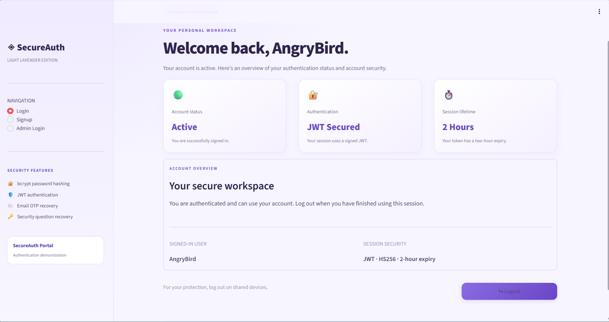
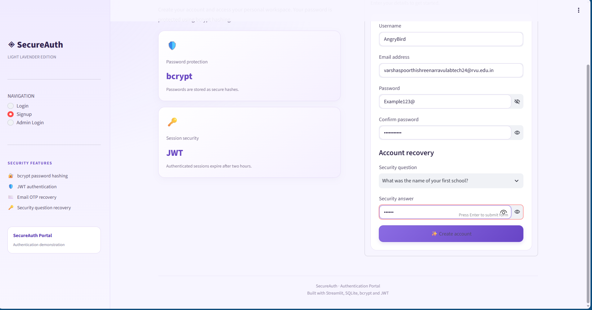
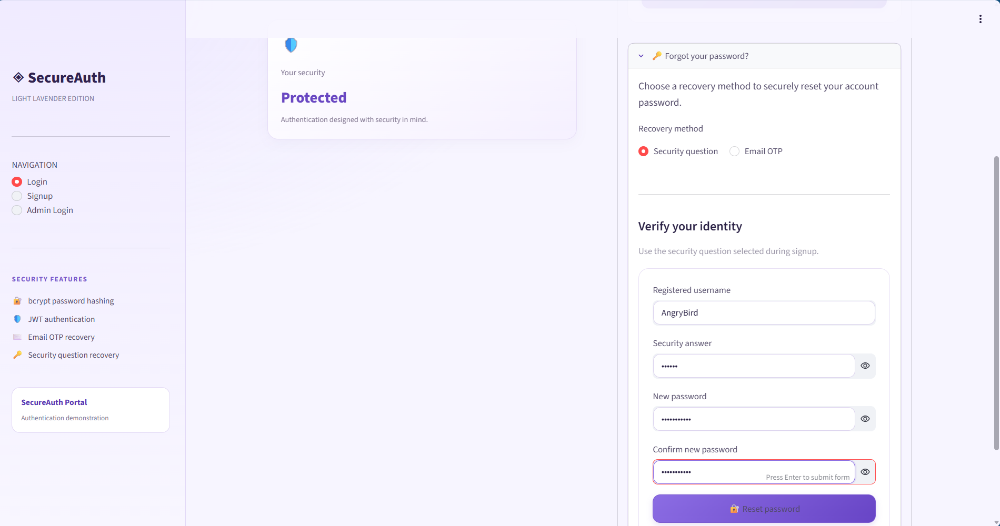
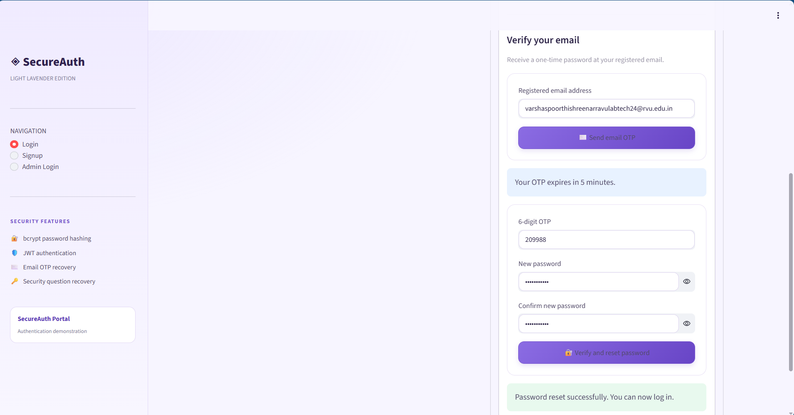
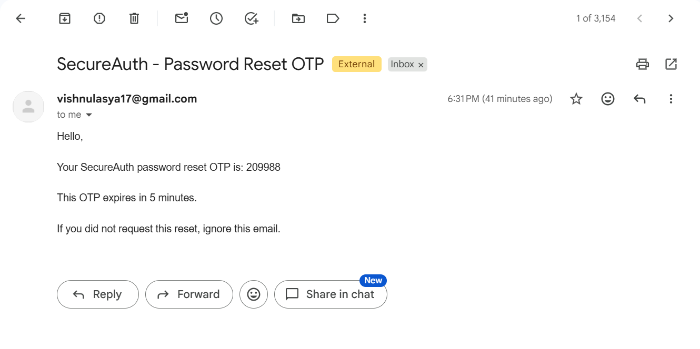
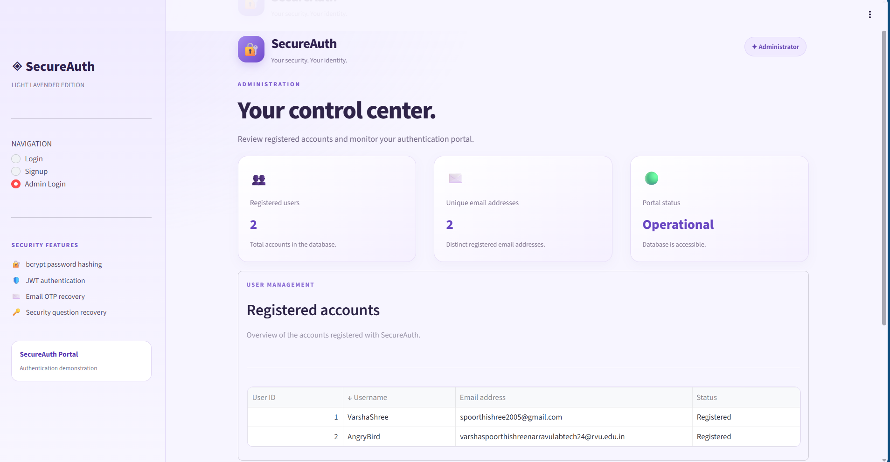

# SecureAuth – User Authentication System

A secure, web-based authentication application built using **Python and Streamlit** as part of **Infosys Springboard Internship 7.0 – Milestone 1**.

SecureAuth provides user registration, login, password recovery through security questions or email OTP, JWT-based session authentication, and a separate administrator dashboard for viewing registered users.

## 📌 Project Overview

The objective of this project is to develop a functional authentication system that demonstrates secure user registration, password management, session handling, and administrative access.

The application uses SQLite to store user information, bcrypt to hash passwords, JWT to authenticate user sessions, and Gmail SMTP to deliver one-time passwords for account recovery.

## ✨ Features

### 1. User Registration
- Create an account using a unique username and email address.
- Validate email addresses and password strength.
- Require at least eight characters, including uppercase and lowercase letters, a digit, and a special character.
- Store passwords and security answers as bcrypt hashes.
- Select a security question during registration.

### 2. User Login
- Authenticate users using their registered username and password.
- Verify passwords against stored bcrypt hashes.
- Generate a signed JWT after successful authentication.
- Configure JWT sessions to expire after two hours.

### 3. Password Recovery

Users can recover their accounts using either of the following methods.

#### Security Question Recovery
- Verify the registered username and security answer.
- Validate the new password.
- Update the stored password hash after successful verification.

#### Email OTP Recovery
- Generate a six-digit one-time password.
- Send the OTP to the registered email address through Gmail SMTP.
- Set a five-minute OTP expiry.
- Limit OTP verification to five attempts.
- Allow users to set a new password after successful verification.

### 4. User Dashboard
- Display a personalized welcome message.
- Show account status and authentication information.
- Provide a logout option to end the session.

### 5. Admin Login and Dashboard
- Provide a separate administrator login.
- Configure the admin password through Google Colab Secrets.
- Display the total number of registered users.
- Display the number of unique email addresses.
- Show a table containing registered user IDs, usernames, email addresses, and registration status.
- Provide a separate admin logout option.

The dashboard does not display users' password hashes or security-answer hashes.

### 6. User Interface
- Light lavender and white theme with purple accents.
- Styled login, registration, recovery, and dashboard pages.
- Rounded buttons, card-based layouts, and responsive page structure.
- Sidebar navigation for Login, Signup, and Admin Login.

## 🛠️ Technology Stack

| Technology | Purpose |
|---|---|
| Python | Core application logic |
| Streamlit | Web interface and navigation |
| SQLite | User data storage |
| bcrypt | Password and security-answer hashing |
| PyJWT | JWT creation and verification |
| Gmail SMTP | Email OTP delivery |
| ngrok | Expose the Streamlit application through a public URL |
| Google Colab | Development and execution environment |
| GitHub | Source code and project submission |

## 📂 Project Structure

```text
Milestone1/
├── README.md
├── authentication_app.ipynb
└── screenshots/
    ├── login.png
    ├── signup.png
    ├── forgot_password_security_question.png
    ├── forgot_password_email_otp.png
    ├── otp_email.png
    ├── user_dashboard.png
    └── admin_dashboard.png
```

> **Note:** The screenshot filenames above are examples. Replace them with your actual filenames if they differ.

## 📸 Application Screenshots

### 1. Login Page



### 2. Signup Page



### 3. Password Recovery – Security Question



### 4. Password Recovery – Email OTP



### 5. OTP Email




### 6. Admin Dashboard



## ⚙️ Setup and Execution

### Prerequisites

- A Google account to use Google Colab.
- A Gmail account with an app password enabled for SMTP authentication.
- A GitHub account.
- An ngrok account and authentication token.

### Step 1: Open the Notebook

Open `authentication_app.ipynb` in Google Colab.

### Step 2: Install Dependencies

Run the installation cell:

```python
%pip install -q streamlit pyjwt bcrypt pyngrok
```

### Step 3: Configure Secrets

Open the **Secrets** panel in Google Colab and configure the following secrets:

| Secret Name | Description |
|---|---|
| `JWT_SECRET` | Secret key used to sign JWT tokens |
| `EMAIL_ADDRESS` | Gmail address used to send OTP emails |
| `EMAIL_PASSWORD` | Gmail app password for SMTP authentication |
| `ADMIN_PASSWORD` | Password for the administrator account |
| `NGROK_AUTHTOKEN` | Authentication token used by ngrok |

Enable notebook access for the required secrets.

**Security note:** Never hardcode actual credentials in the notebook or commit them to GitHub.

### Step 4: Load Secrets

Load the secrets into the notebook environment before starting the application.

```python
from google.colab import userdata
import os

for key in [
    "JWT_SECRET",
    "EMAIL_ADDRESS",
    "EMAIL_PASSWORD",
    "ADMIN_PASSWORD",
    "NGROK_AUTHTOKEN"
]:
    os.environ[key] = userdata.get(key)
```

### Step 5: Run the Application

Execute the notebook cells in order. The notebook installs the dependencies, configures the environment, and launches the Streamlit application through ngrok.

Open the generated ngrok URL to access SecureAuth.

### Step 6: Access the Application

**User access**
1. Register a new account using the Signup page.
2. Log in with the registered credentials.
3. Test security-question or email-OTP password recovery.
4. Access the user dashboard and test logout.

**Administrator access**
1. Open the Admin Login page.
2. Use the username `admin`.
3. Enter the password configured in the `ADMIN_PASSWORD` secret.
4. View the registered-users dashboard.
5. Test admin logout.

## 🔐 Security Considerations

- Passwords are hashed using bcrypt rather than stored as plaintext.
- Security answers are stored as bcrypt hashes.
- JWT tokens are signed using a secret key and have a two-hour expiry.
- Password reset OTPs expire after five minutes and have a five-attempt verification limit.
- Sensitive credentials are configured through Google Colab Secrets.
- The administrator dashboard displays usernames and email addresses, not password or security-answer hashes.

This project is intended as an educational demonstration. Production deployments would require additional controls, including rate limiting, securely managed recovery state, and stronger session and account protections.

## 🚀 Future Enhancements

- Add multi-factor authentication.
- Implement account lockout and rate limiting.
- Add email verification during registration.
- Improve audit logging and administrative monitoring.
- Deploy the application to a persistent hosting platform.

## 👩‍💻 Project Information

- **Program:** Infosys Springboard Internship 7.0
- **Milestone:** Milestone 1
- **Project:** SecureAuth – User Authentication System
- **Environment:** Google Colab
- **Repository:** GitHub

---

*Developed as part of the Infosys Springboard Internship 7.0 Milestone 1 submission.*
